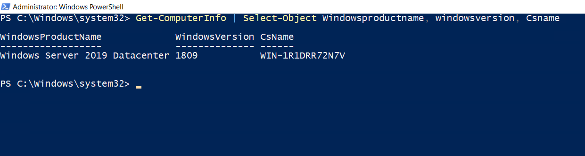
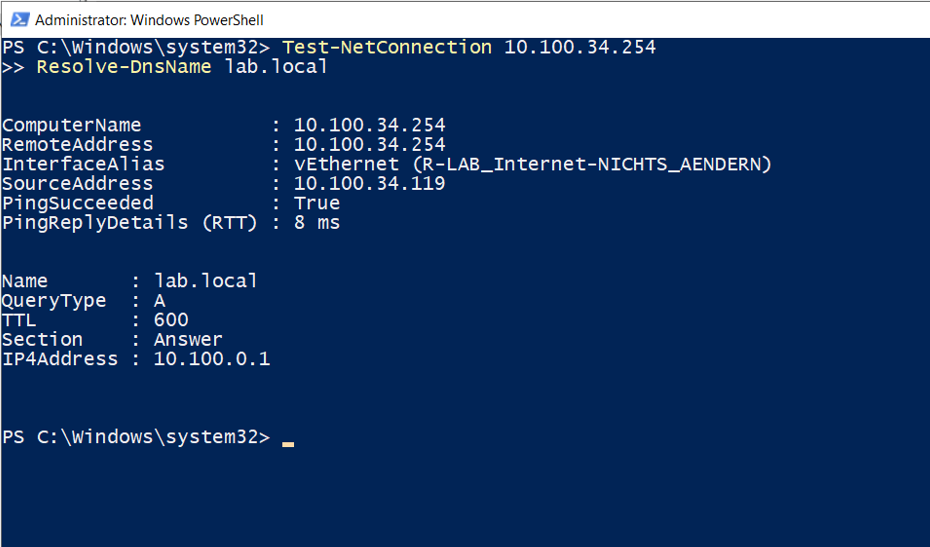

# Windows Server Grundlagen

## Systemübersicht

Der Server wurde über PowerShell geprüft. Dabei wurden Windows-Version und Hostname ermittelt.

```powershell
Get-ComputerInfo | Select-Object WindowsProductName, WindowsVersion, CsName
```



## Netzwerkprüfung

Die Erreichbarkeit des Standardgateways und die DNS-Namensauflösung wurden erfolgreich geprüft.

```powershell
Test-NetConnection 10.100.34.254
Resolve-DnsName lab.local
```


