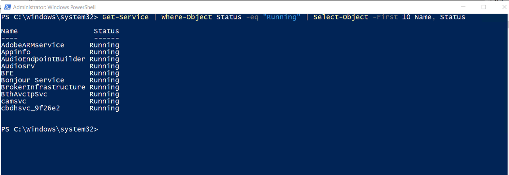
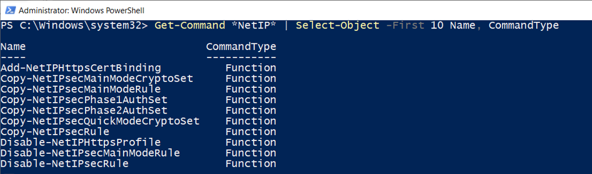

# PowerShell Grundlagen

## Laufende Dienste

Mit einer PowerShell-Pipeline wurden aktive Windows-Dienste gefiltert und übersichtlich ausgegeben.

```powershell
Get-Service | Where-Object Status -eq "Running" | Select-Object -First 10 Name, Status
```



## Befehlssuche

Verfügbare PowerShell-Befehle für die Netzwerk- und IP-Verwaltung wurden gesucht.

```powershell
Get-Command *NetIP* | Select-Object -First 10 Name, CommandType
```


