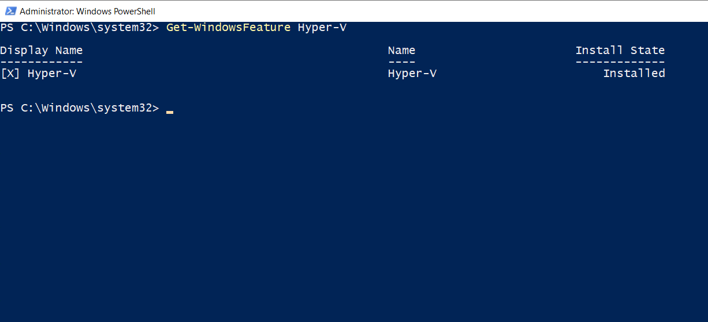

# Hyper-V Host

## Installationsstatus

Der Installationsstatus der Hyper-V-Rolle wurde mit PowerShell geprüft.

```powershell
Get-WindowsFeature Hyper-V
```

Die Ausgabe bestätigt, dass Hyper-V installiert ist.


