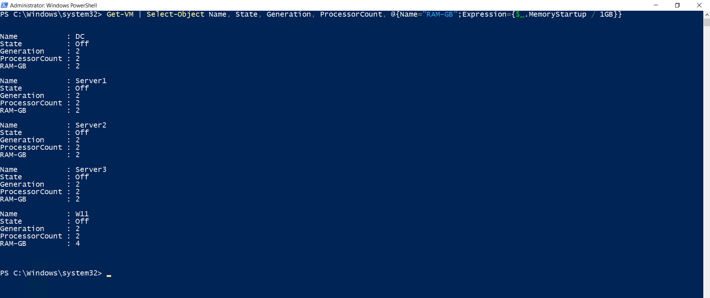

# Virtuelle Maschinen

## Konfiguration

Für die Testumgebung wurden fünf virtuelle Maschinen in Hyper-V eingerichtet:

- DC
- Server1
- Server2
- Server3
- W11

Alle virtuellen Maschinen verwenden Generation 2 und sind mit dem virtuellen Switch `Firmennetz` verbunden.

Die Server wurden mit jeweils 2 Prozessoren, 2 GB Arbeitsspeicher und Windows Server 2022 installiert. Der Windows-11-Client verwendet 2 Prozessoren, 4 GB Arbeitsspeicher, Secure Boot und TPM.

## Prüfung

Die abschließende PowerShell-Ausgabe zeigt die vorhandenen virtuellen Maschinen und deren Konfiguration.

```powershell
Get-VM | Select-Object Name, State, Generation, ProcessorCount, @{Name="RAM-GB";Expression={$_.MemoryStartup / 1GB}}
```


