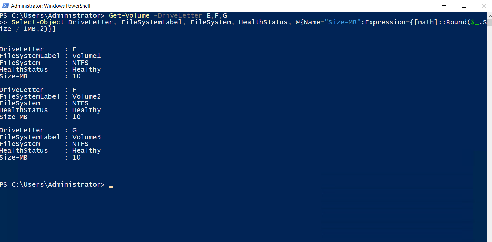

# Lokaler Speicher

## Datentraeger

Fuer `Server3` wurden drei dynamische VHDX-Datentraeger mit jeweils 20 GB erstellt und ueber den SCSI-Controller eingebunden.

## Volumes

Auf den drei Datentraegern wurde jeweils ein Volume mit 10 MB, NTFS und GPT eingerichtet:

- `E:` – `Volume1` ueber die Datentraegerverwaltung
- `F:` – `Volume2` ueber DiskPart
- `G:` – `Volume3` ueber PowerShell

### PowerShell-Pruefung

```powershell
Get-Volume -DriveLetter E,F,G |
Select-Object DriveLetter, FileSystemLabel, FileSystem, HealthStatus, @{Name="Size-MB";Expression={[math]::Round($_.Size / 1MB,2)}}
```

Die Ausgabe bestaetigt fuer alle drei Volumes das Dateisystem NTFS, den Status `Healthy` und eine Groesse von 10 MB.


