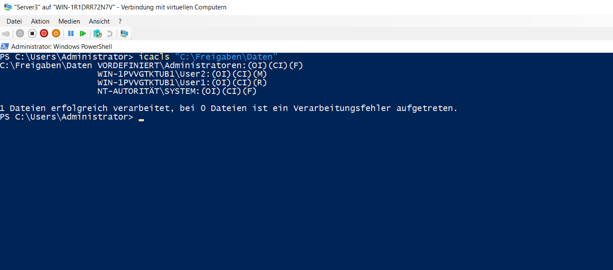
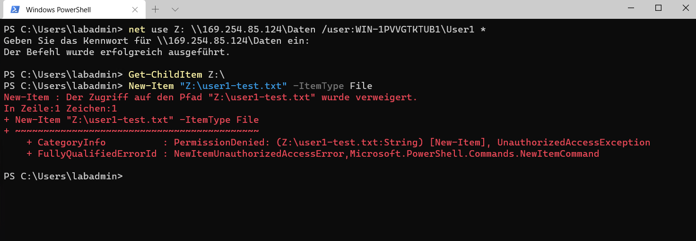
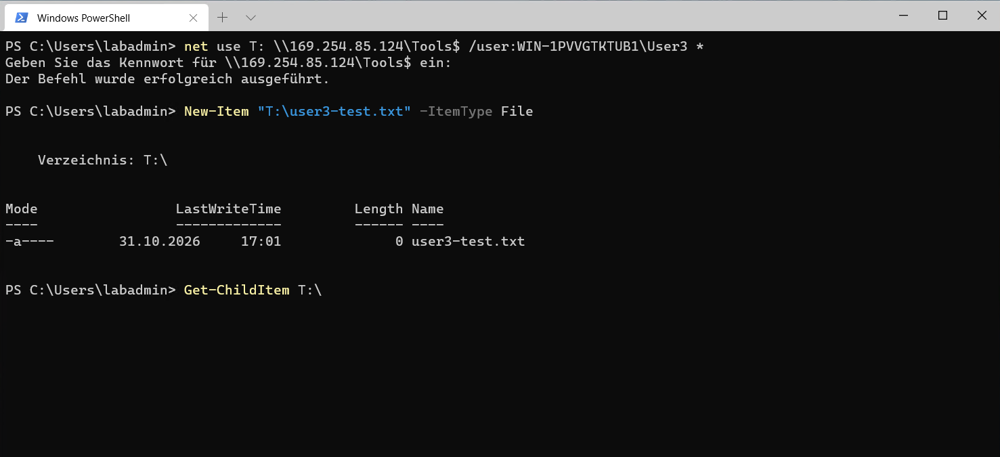

# Freigaben und Berechtigungen

## Ordner und Benutzer

Auf `Server3` wurden die Ordner `Daten`, `Tools` und `Backup` sowie die lokalen Benutzer `User1`, `User2` und `User3` eingerichtet.

## Datenfreigabe

Der Ordner `C:\Freigaben\Daten` wurde als `Daten` freigegeben. Die NTFS-Berechtigungen wurden wie folgt gesetzt:

- `User1`: Lesen
- `User2`: Ändern
- `Administratoren`: Vollzugriff
- `SYSTEM`: Vollzugriff

```powershell
icacls "C:\Freigaben\Daten"
```



## Zugriffstest

Der Zugriff wurde von `W11` mit beiden Benutzerkonten geprüft. `User1` konnte Inhalte lesen, aber keine Datei erstellen. `User2` konnte eine neue Datei erstellen.

```powershell
net use Z: \\169.254.85.124\Daten /user:WIN-1PVVGTKTUB1\User1 *
Get-ChildItem Z:\
New-Item "Z:\user1-test.txt" -ItemType File
```



```powershell
net use Z: \\169.254.85.124\Daten /user:WIN-1PVVGTKTUB1\User2 *
New-Item "Z:\user2-test.txt" -ItemType File
Get-ChildItem Z:\
```


## Versteckte Freigabe

Der Ordner `C:\Freigaben\Tools` wurde als versteckte Freigabe `Tools$` eingerichtet. `User3` erhielt Änderungsrechte und konnte eine Testdatei erstellen.

```powershell
net use T: \\169.254.85.124\Tools$ /user:WIN-1PVVGTKTUB1\User3 *
New-Item "T:\user3-test.txt" -ItemType File
Get-ChildItem T:\
```


