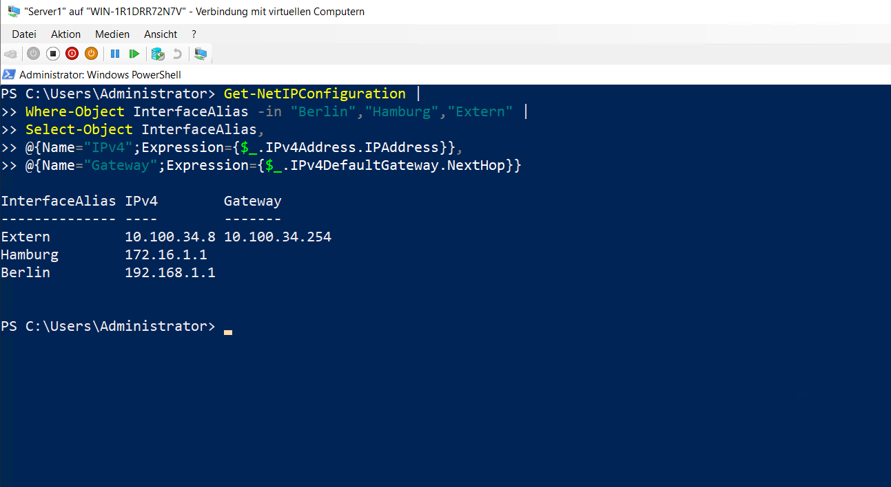
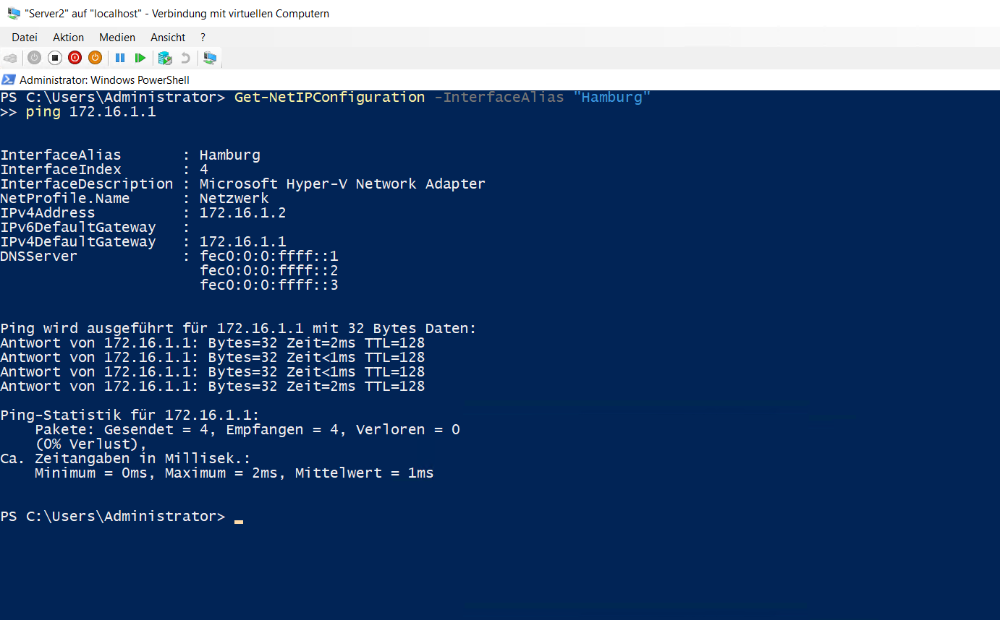
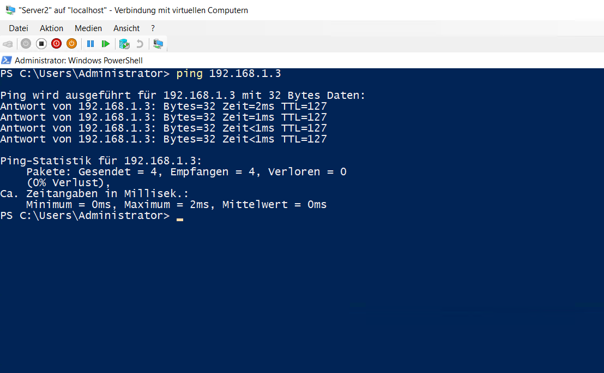

# IP-Adressierung und Routing

## Netzwerke

Für die Umgebung wurden die privaten virtuellen Switches `Berlin` und `Hamburg` eingerichtet.

Die Systeme verwenden folgende IPv4-Konfiguration:

- `DC`: `192.168.1.3/24`, Gateway `192.168.1.1`
- `Server1 Berlin`: `192.168.1.1/24`
- `Server1 Hamburg`: `172.16.1.1/24`
- `Server1 Extern`: externe Netzwerkkarte mit DHCP
- `Server2`: `172.16.1.2/24`, Gateway `172.16.1.1`

## Server1

`Server1` besitzt drei Netzwerkadapter für die beiden internen Netze und die externe Verbindung.

```powershell
Get-NetIPConfiguration |
Where-Object InterfaceAlias -in "Berlin","Hamburg","Extern" |
Select-Object InterfaceAlias,
@{Name="IPv4";Expression={$_.IPv4Address.IPAddress}},
@{Name="Gateway";Expression={$_.IPv4DefaultGateway.NextHop}}
```



## Server2

`Server2` wurde im Netz `Hamburg` konfiguriert. Der Verbindungstest zur Hamburg-Schnittstelle von `Server1` war erfolgreich.

```powershell
Get-NetIPConfiguration -InterfaceAlias "Hamburg"
ping 172.16.1.1
```



## LAN-Routing

Auf `Server1` wurde `LAN-Routing` über Routing und RAS aktiviert. Anschließend konnte `Server2` den `DC` im Netz `Berlin` erreichen.

```powershell
ping 192.168.1.3
```

Der Test wurde ohne Paketverlust abgeschlossen.


