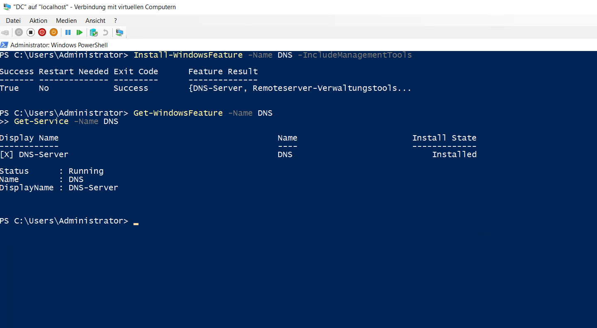
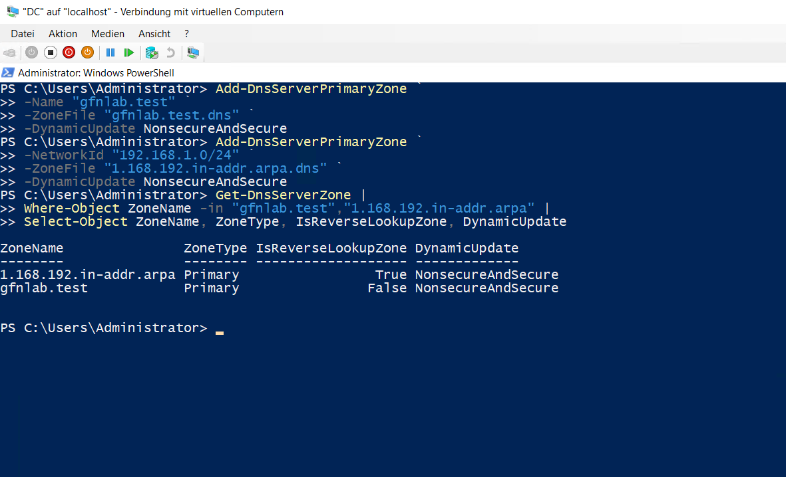
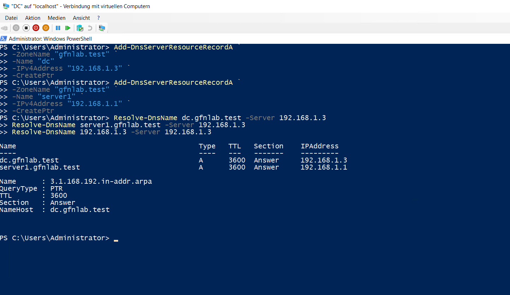

# DNS-Namensauflösung

## DNS-Server

Auf dem `DC` wurde die Rolle `DNS-Server` einschließlich der Verwaltungswerkzeuge installiert. Der DNS-Dienst wurde anschließend geprüft.

```powershell
Install-WindowsFeature -Name DNS -IncludeManagementTools
Get-WindowsFeature -Name DNS
Get-Service -Name DNS
```



## DNS-Zonen

Für die Namensauflösung wurde die Forward-Lookupzone `gfnlab.test` eingerichtet. Für das Netz `192.168.1.0/24` wurde zusätzlich eine Reverse-Lookupzone erstellt. Dynamische Updates sind für beide Zonen aktiviert.

```powershell
Get-DnsServerZone |
Where-Object ZoneName -in "gfnlab.test","1.168.192.in-addr.arpa" |
Select-Object ZoneName, ZoneType, IsReverseLookupZone, DynamicUpdate
```



## DNS-Einträge und Prüfung

Für `DC` und `Server1` wurden A- und PTR-Records erstellt. Die Vorwärts- und Rückwärtsauflösung wurde anschließend mit `Resolve-DnsName` geprüft.

```powershell
Resolve-DnsName dc.gfnlab.test -Server 192.168.1.3
Resolve-DnsName server1.gfnlab.test -Server 192.168.1.3
Resolve-DnsName 192.168.1.3 -Server 192.168.1.3
```

Die Abfragen lösen `dc.gfnlab.test` zu `192.168.1.3`, `server1.gfnlab.test` zu `192.168.1.1` und `192.168.1.3` zurück zu `dc.gfnlab.test` auf.


