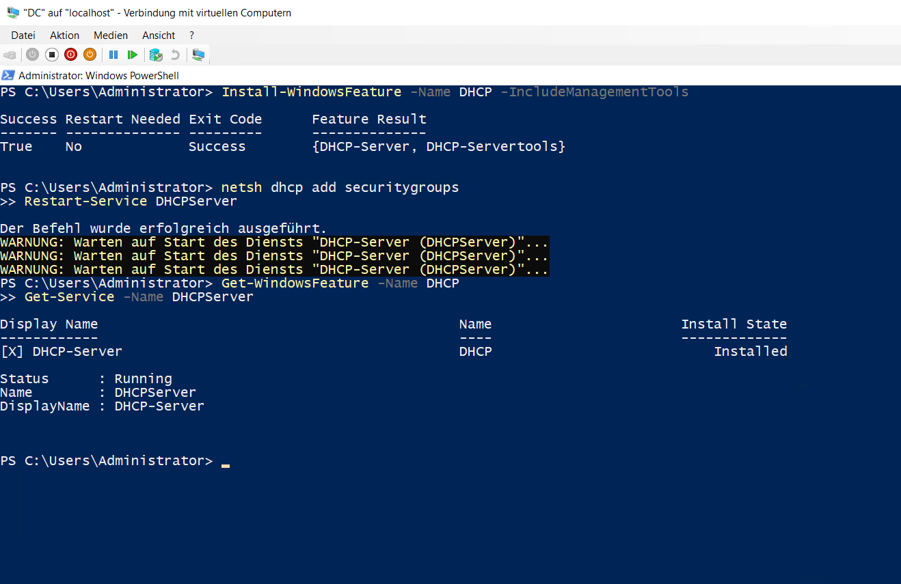
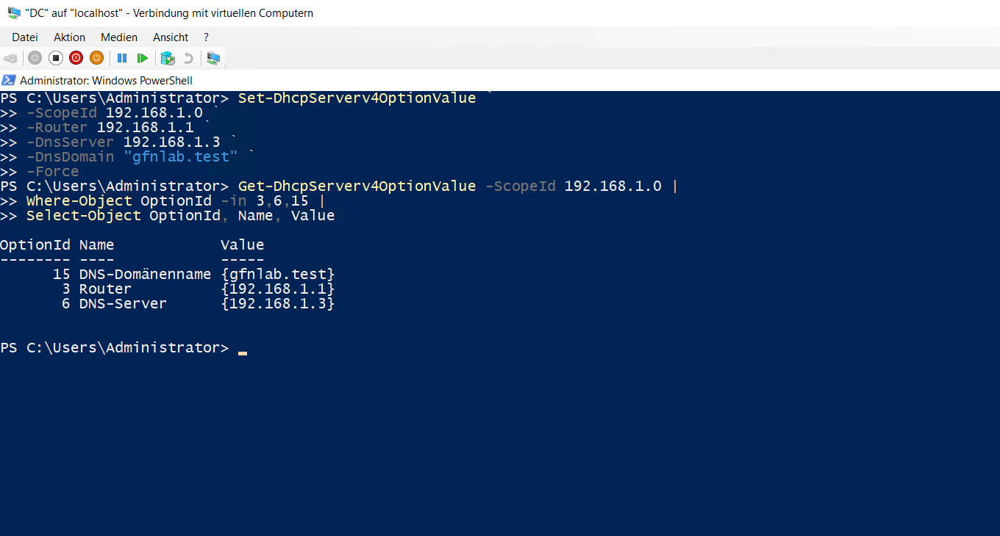
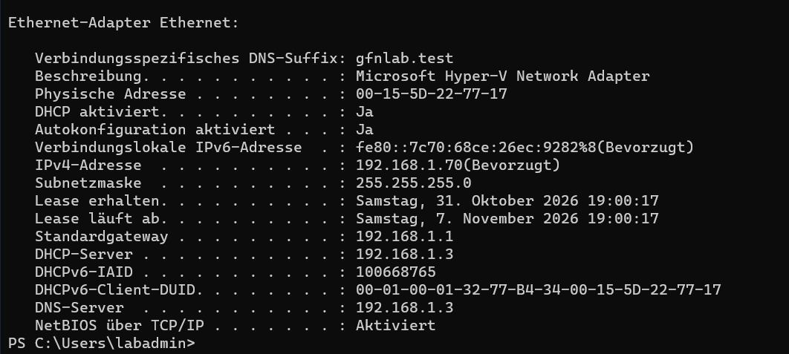

# DHCP-Konfiguration

## DHCP-Server

Auf dem `DC` wurde die Rolle `DHCP-Server` einschließlich der Verwaltungswerkzeuge installiert. Anschließend wurden die DHCP-Sicherheitsgruppen eingerichtet und der Dienst geprüft.

```powershell
Install-WindowsFeature -Name DHCP -IncludeManagementTools
netsh dhcp add securitygroups
Restart-Service DHCPServer
Get-Service -Name DHCPServer
```



## Adressbereiche

Für das Netz `192.168.1.0/24` wurde der Bereich `Bereich 1` eingerichtet:

- Adressbereich: `192.168.1.50` bis `192.168.1.120`
- Ausschlussbereich: `192.168.1.80` bis `192.168.1.90`
- Leasedauer: 7 Tage

Zusätzlich wurden `Bereich 2` für `192.168.2.0/24` und der aktive Multicastbereich `224.1.1.1` bis `224.1.1.9` eingerichtet.

## Bereichsoptionen

Für `Bereich 1` wurden Router, DNS-Server und DNS-Domäne konfiguriert.

```powershell
Set-DhcpServerv4OptionValue `
-ScopeId 192.168.1.0 `
-Router 192.168.1.1 `
-DnsServer 192.168.1.3 `
-DnsDomain "gfnlab.test" `
-Force

Get-DhcpServerv4OptionValue -ScopeId 192.168.1.0 |
Where-Object OptionId -in 3,6,15 |
Select-Object OptionId, Name, Value
```



## Reservierung für W11

Für den Windows-11-Client wurde anhand der MAC-Adresse `00-15-5D-22-77-17` eine Reservierung mit der Adresse `192.168.1.70` erstellt.

```powershell
Add-DhcpServerv4Reservation `
-ScopeId 192.168.1.0 `
-IPAddress 192.168.1.70 `
-ClientId "00-15-5D-22-77-17" `
-Name "W11"
```

Nach der Erneuerung der DHCP-Konfiguration erhielt der Client die reservierte Adresse sowie den konfigurierten Standardgateway, DNS-Server und DNS-Suffix.

```powershell
ipconfig /release
ipconfig /renew
ipconfig /all
```


