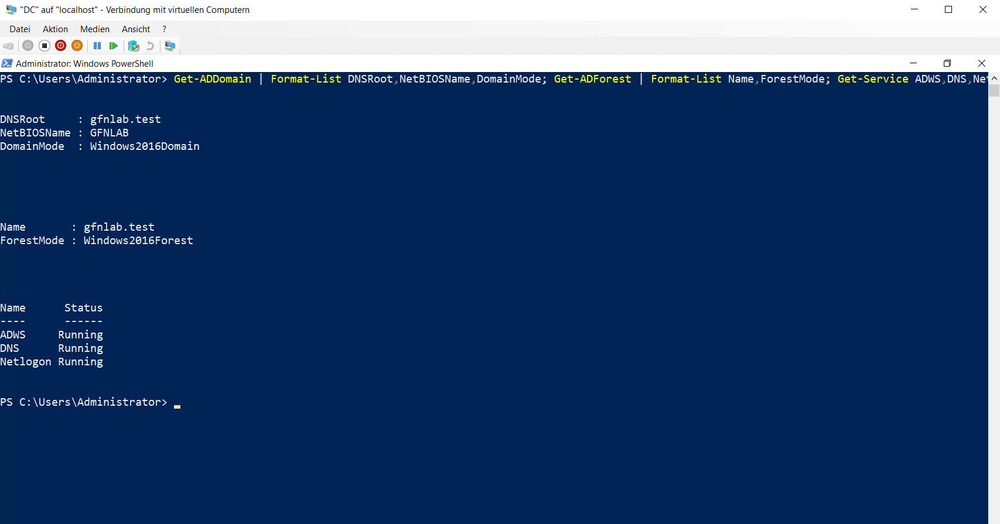
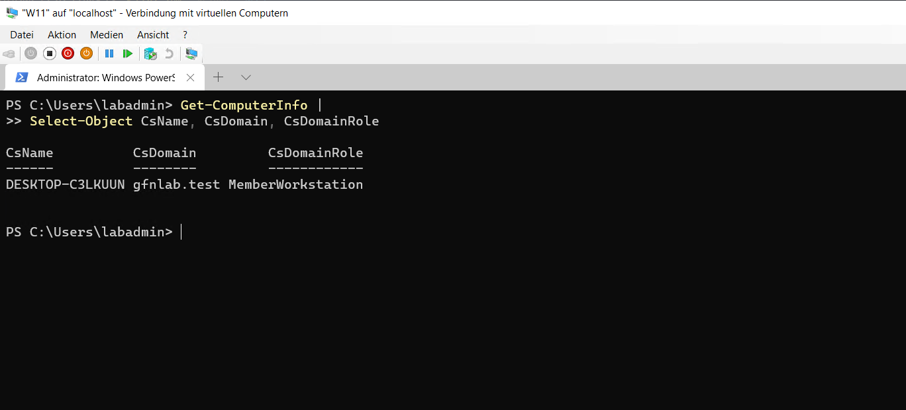

# Active Directory Domain

## Active Directory Domain Services

Auf dem Server `DC` wurde die Rolle `Active Directory-Domänendienste` einschließlich der Verwaltungswerkzeuge installiert.

```powershell
Install-WindowsFeature AD-Domain-Services -IncludeManagementTools
```

Anschließend wurde eine neue Gesamtstruktur mit der Domäne `gfnlab.test` und dem NetBIOS-Namen `GFNLAB` erstellt.

```powershell
$DSRM = Read-Host "DSRM-Kennwort" -AsSecureString

Install-ADDSForest `
-DomainName "gfnlab.test" `
-DomainNetbiosName "GFNLAB" `
-InstallDns:$true `
-SafeModeAdministratorPassword $DSRM `
-Force
```

## Domänenstatus

Die Domäne und Gesamtstruktur verwenden die Funktionsebene Windows Server 2016. Die Dienste `ADWS`, `DNS` und `Netlogon` wurden nach der Installation geprüft.

```powershell
Get-ADDomain | Format-List DNSRoot,NetBIOSName,DomainMode
Get-ADForest | Format-List Name,ForestMode
Get-Service ADWS,DNS,Netlogon | Format-Table Name,Status -AutoSize
```



## Domänenbeitritt von W11

Der Windows-11-Client wurde der Domäne `gfnlab.test` hinzugefügt.

```powershell
Add-Computer `
-DomainName "gfnlab.test" `
-Credential "GFNLAB\Administrator" `
-Restart
```

Nach dem Neustart wurde die Domänenmitgliedschaft geprüft. Der Client wird als `MemberWorkstation` geführt.

```powershell
Get-ComputerInfo |
Select-Object CsName, CsDomain, CsDomainRole
```


