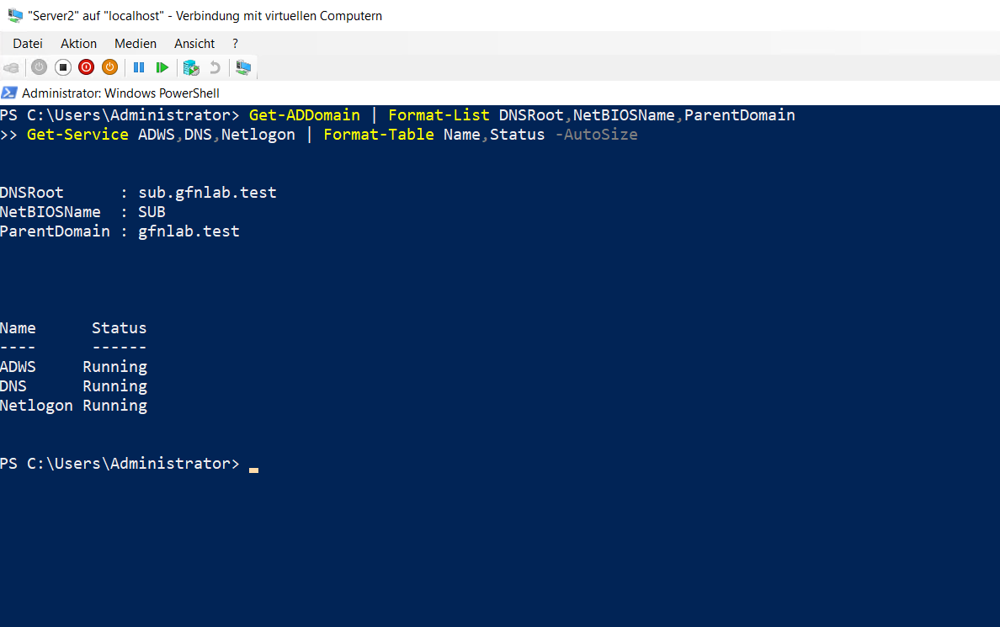
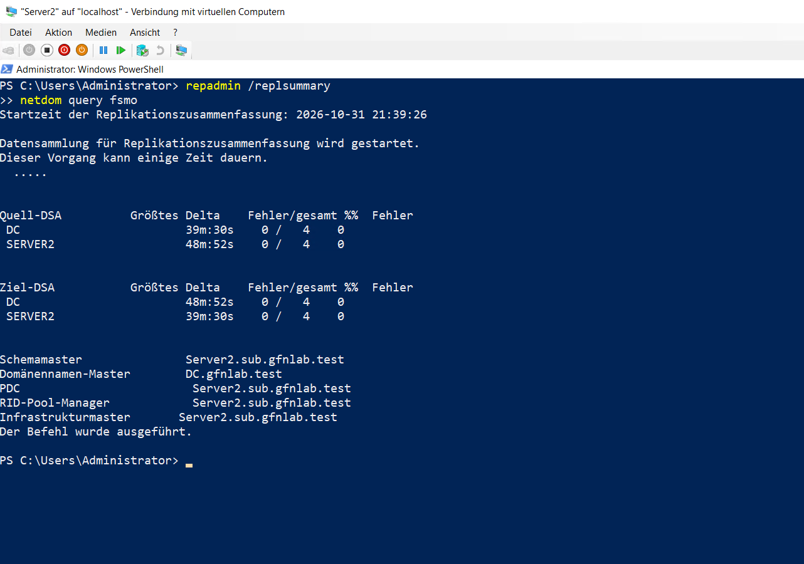

# Active Directory-Infrastruktur

## Untergeordnete Domäne

Auf `Server2` wurde eine untergeordnete Domäne für die bestehende Gesamtstruktur eingerichtet.

- Stammdomäne: `gfnlab.test`
- Untergeordnete Domäne: `sub.gfnlab.test`
- NetBIOS-Name: `SUB`
- Domänencontroller: `Server2.sub.gfnlab.test`

```powershell
Install-ADDSDomain `
-NewDomainName "sub" `
-ParentDomainName "gfnlab.test" `
-NewDomainNetbiosName "SUB" `
-DomainType ChildDomain `
-InstallDns `
-Credential $Credential `
-SafeModeAdministratorPassword $DSRM `
-Force
```

Nach dem Neustart wurden die Domäne und die erforderlichen Dienste geprüft.

```powershell
Get-ADDomain | Format-List DNSRoot,NetBIOSName,ParentDomain
Get-Service ADWS,DNS,Netlogon | Format-Table Name,Status -AutoSize
```



## Replikation und FSMO-Rollen

Die Replikation zwischen `DC` und `Server2` wurde geprüft. Die Zusammenfassung zeigt für beide Domänencontroller keine Replikationsfehler.

Anschließend wurde die Rolle `Schema Master` von `DC.gfnlab.test` auf `Server2.sub.gfnlab.test` übertragen. Der `Domain Naming Master` verbleibt auf `DC.gfnlab.test`.

```powershell
repadmin /replsummary
netdom query fsmo
```


