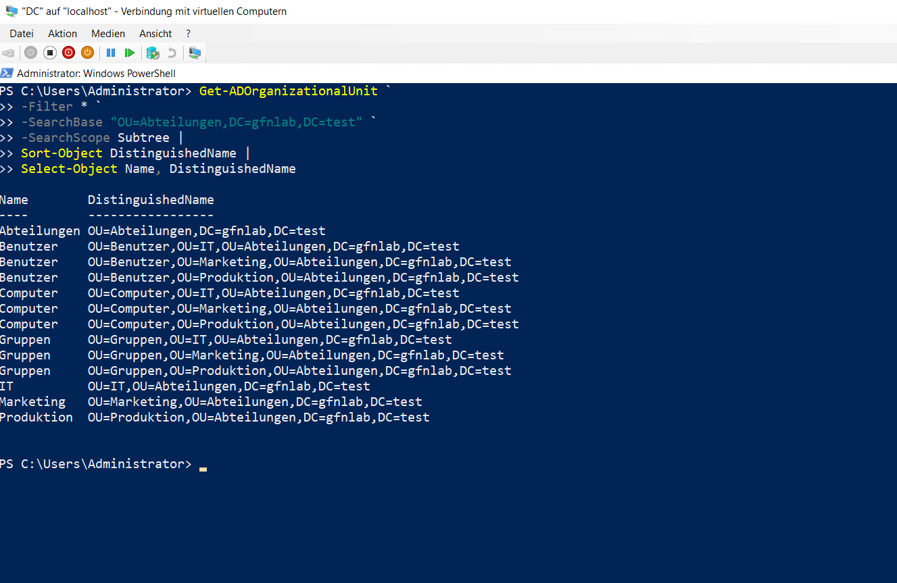
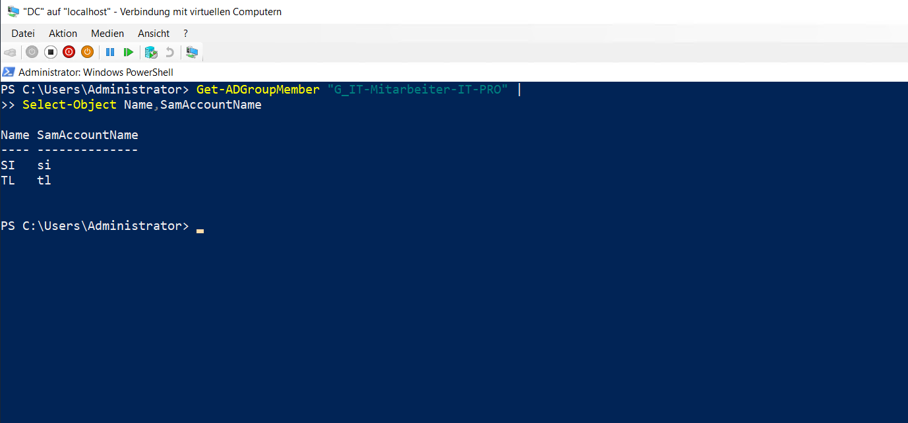
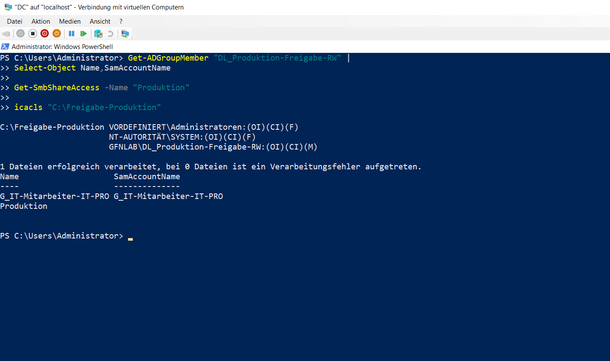

# Active Directory-Verwaltung

## Organisationseinheiten

Für die Abteilungen `IT`, `Marketing` und `Produktion` wurde eine strukturierte OU-Hierarchie erstellt. Jede Abteilung enthält die Organisationseinheiten `Benutzer`, `Computer` und `Gruppen`.

```powershell
Get-ADOrganizationalUnit `
-Filter * `
-SearchBase "OU=Abteilungen,DC=gfnlab,DC=test" `
-SearchScope Subtree |
Sort-Object DistinguishedName |
Select-Object Name, DistinguishedName
```



## Benutzer und globale Gruppe

In der OU `IT/Benutzer` wurden die Benutzer `SI` und `TL` angelegt. Beide Benutzer wurden der globalen Sicherheitsgruppe `G_IT-Mitarbeiter-IT-PRO` hinzugefügt.

```powershell
Get-ADGroupMember "G_IT-Mitarbeiter-IT-PRO" |
Select-Object Name, SamAccountName
```



## Produktionsfreigabe

Für `C:\Freigabe-Produktion` wurde die Domain-Local-Gruppe `DL_Produktion-Freigabe-RW` eingerichtet. Die globale IT-Gruppe wurde darin verschachtelt.

Die Domain-Local-Gruppe besitzt auf der SMB-Freigabe die Berechtigung `Change` und auf dem Dateisystem die NTFS-Berechtigung `Modify`.

```powershell
Get-ADGroupMember "DL_Produktion-Freigabe-RW" |
Select-Object Name, SamAccountName

Get-SmbShareAccess -Name "Produktion"

icacls "C:\Freigabe-Produktion"
```


