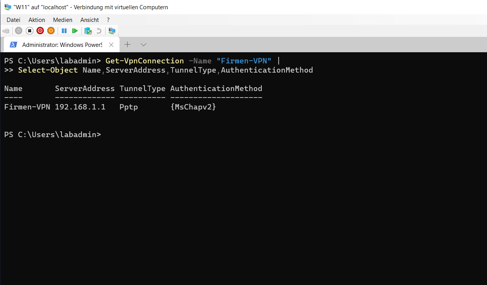
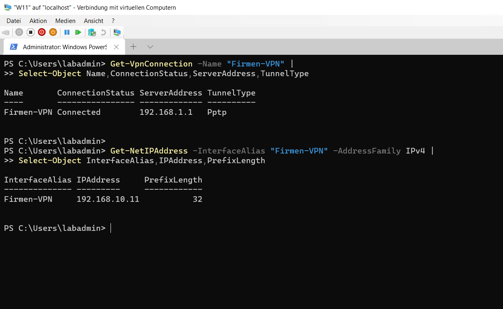

# VPN und Remote Access

## VPN-Server

Auf `Server1` wurde der VPN-Zugriff über Routing und RAS eingerichtet. Für VPN-Clients wurde ein statischer Adresspool konfiguriert.

- VPN-Typ: PPTP
- IP-Adresspool: `192.168.10.10` bis `192.168.10.20`
- IP-Zuweisung: Static Pool
- Dienst: `RemoteAccess`

```powershell
Get-RemoteAccess |
Format-List VpnStatus,IPAssignmentMethod,IPAddressRangeList

Get-Service RemoteAccess |
Format-Table Name,Status,StartType -AutoSize
```


## VPN-Client

Auf `W11` wurde die Verbindung `Firmen-VPN` mit `Server1` als VPN-Server eingerichtet.

```powershell
Add-VpnConnection `
-Name "Firmen-VPN" `
-ServerAddress "192.168.1.1" `
-TunnelType Pptp `
-AuthenticationMethod MSChapv2 `
-EncryptionLevel Required `
-RememberCredential `
-Force
```

```powershell
Get-VpnConnection -Name "Firmen-VPN" |
Select-Object Name,ServerAddress,TunnelType,AuthenticationMethod
```



## Verbindungstest

Der Benutzer `si@gfnlab.test` konnte die VPN-Verbindung erfolgreich herstellen. Der Client erhielt die VPN-Adresse `192.168.10.11` aus dem konfigurierten Adresspool.

```powershell
rasdial "Firmen-VPN" "si@gfnlab.test" *

Get-VpnConnection -Name "Firmen-VPN" |
Select-Object Name,ConnectionStatus,ServerAddress,TunnelType

Get-NetIPAddress -InterfaceAlias "Firmen-VPN" -AddressFamily IPv4 |
Select-Object InterfaceAlias,IPAddress,PrefixLength
```


